## ¿Dónde están las playas que debemos monitorear?

::: {.columns}
::: {.column width="56%"}
- El análisis histórico del litoral necesita identificar **tramos arenosos candidatos**.
- Una selección manual nacional dificulta escalar y reproducir el procedimiento.
- Clasificar primero permite **priorizar la extracción de líneas de costa con CoastSat**.

**Pregunta:** ¿podemos identificar automáticamente playas arenosas en el litoral dominicano?
:::
::: {.column width="44%"}
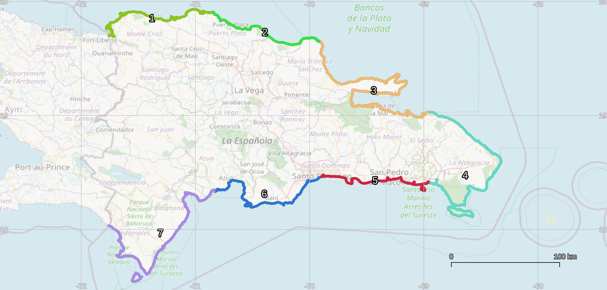{fig-alt="Preparación de geometrías costeras en QGIS" fig-align="center"}
:::
:::

## Objetivo y contribución

**Desarrollar y aplicar un flujo reproducible de clasificación de coberturas costeras para identificar tramos arenosos candidatos a seguimiento multitemporal.**

- Construcción del ámbito litoral dominicano.
- Integración de **22 predictores** de teledetección y topografía.
- Entrenamiento y validación preliminar de **U-Net**.
- Inferencia en **siete sectores costeros**.
- Preparación de insumos para **CoastSat** y análisis de tendencias.

## ¿Por qué clasificar la costa?

::: {.columns}
::: {.column width="50%"}
**Valor científico y operativo**

- Inventario reproducible de ambientes costeros.
- Priorización del monitoreo de playas.
- Identificación de sectores para revisión y trabajo de campo.
- Comparabilidad espacial del procedimiento.
:::
::: {.column width="50%"}
**Aplicación principal**

1. Detectar playas arenosas.
2. Seleccionar tramos candidatos.
3. Ejecutar CoastSat.
4. Estimar desplazamientos, erosión, acreción y estabilidad.

**Advertencia:** la clase playa no equivale automáticamente a una línea de costa extraíble.
:::
:::

## Preparación geométrica en QGIS

{fig-alt="Imagen aportada del procesamiento en QGIS" width="77%" fig-align="center"}

::: {.smaller}
S2Coast2023 (fishnet poligonal) → unión y depuración multipartes/monopartes → unidades insulares ≳9 km² → conversión a polilíneas → cortes en desembocaduras de Dajabón y Pedernales → costa dominicana de La Española + Beata, Saona y Catalina.
:::

## Sectorización del corredor litoral

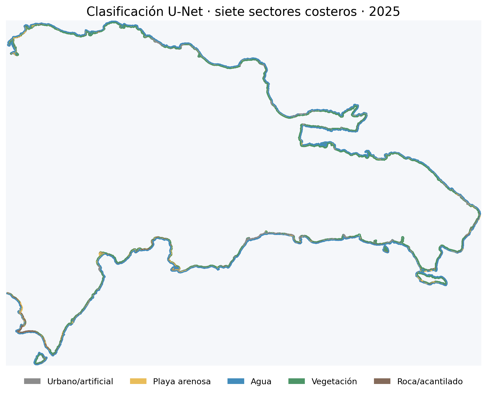{fig-align="center"}

::: {.smaller}
Cuadrícula de referencia de **100 × 100 km**, siete sectores; buffer de **1 km** a cada lado de la línea costera. Mosaico ilustrativo derivado de los rásteres clasificados (no sustituye una delimitación vectorial oficial).
:::

## Fuentes y 22 predictores

| Fuente | Predictores | Número |
|---|---|---:|
| Sentinel-2 SR | B2, B3, B4, B8, B11, B12; NDVI, NDWI, MNDWI, BSI (índice de suelo desnudo), brillo (reflectancia media del visible), BR (reflectancia media visible) | 12 |
| Dynamic World | agua, árboles, herbáceas, construido, desnudo | 5 |
| Sentinel-1 GRD | VV, VH, VV−VH | 3 |
| NASADEM | elevación, pendiente | 2 |
| **Total** | | **22** |

Período de composición: **15 enero–15 marzo de 2025**. Resolución de exportación: **10 m**.

## Arquitectura y entrenamiento

- Modelo de segmentación semántica **U-Net** con cinco clases: urbano/artificial, playa arenosa, agua, vegetación, roca/acantilado.
- Parches de entrada **160 × 160** píxeles, con núcleo de inferencia **128 × 128**.
- Normalización a partir de las estadísticas del entrenamiento.
- Entrenamiento con etiquetas espaciales parciales y pérdida enmascarada.
- Modelo guardado en formato `.keras` y aplicado posteriormente en Colab.

## Del entrenamiento a la cartografía nacional

::: {.columns}
::: {.column width="48%"}
**Google Earth Engine**

1. Composición de predictores.
2. Máscaras de datos válidos y del sector.
3. Exportación GeoTIFF georreferenciada.
:::
::: {.column width="52%"}
**Google Colab**

1. Lectura por ventanas de los GeoTIFF.
2. Normalización y predicción U-Net.
3. Recorte al núcleo central.
4. Exportación de clases, probabilidades y estadísticas.
:::
:::

## Evaluación: la clase de interés importa

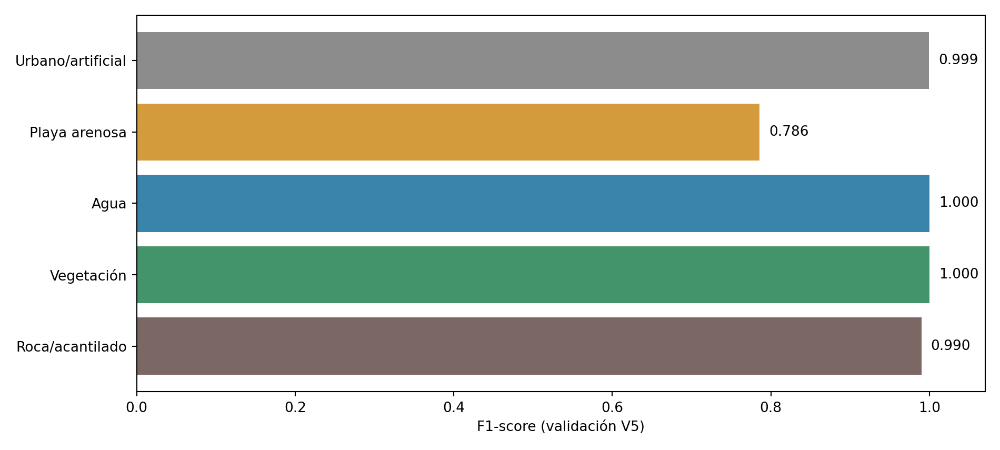{fig-align="center"}

**F1 de playa arenosa: 0,786** · Precisión: **0,740** · Exhaustividad: **0,838**.

::: {.smaller}
Evaluación V5 del conjunto de validación del entrenamiento; **no** es una validación independiente nacional de los siete sectores.
:::

## Matriz de confusión de validación V5

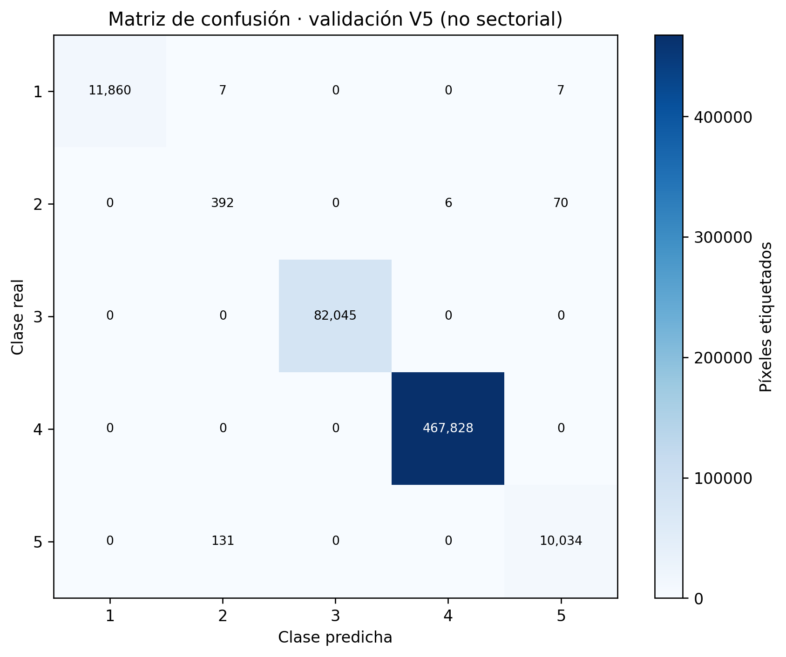{fig-align="center"}

::: {.smaller}
F1 macro ≈ **0,955**; el desequilibrio de clases exige comunicar por separado el rendimiento sobre playa arenosa.
:::

## Cartografía de clasificación: siete sectores

{fig-align="center"}

::: {.smaller}
Mosaico de visualización a resolución reducida a partir de los siete GeoTIFF de clases; en los solapes se utiliza la primera clasificación disponible.
:::

## Superficies clasificadas por sector

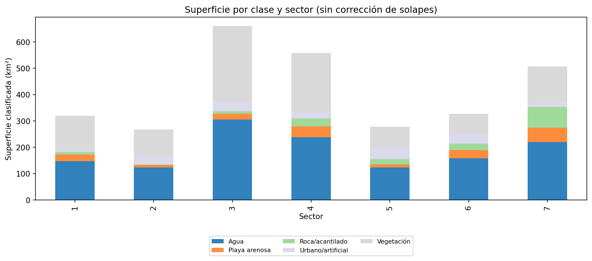{fig-align="center"}

::: {.smaller}
Las superficies proceden de los CSV de inferencia. **No sumar como superficie nacional única sin resolver previamente los solapes entre sectores.**
:::

## ¿Cuánta superficie se clasifica como playa?

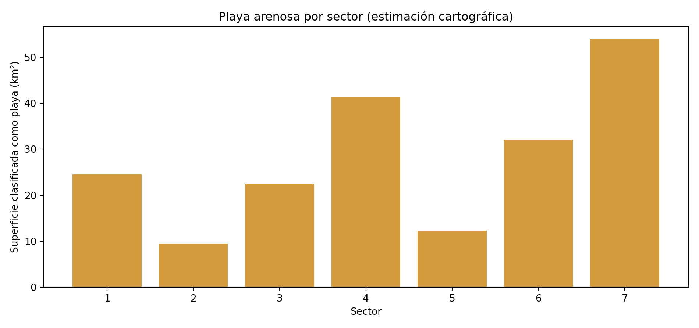{fig-align="center"}

::: {.smaller}
La suma simple de las siete estimaciones es **196,17 km²**, con posibles dobles conteos por solapes. Es superficie de píxeles etiquetados «playa», no longitud de costa ni inventario validado de playas.
:::

## Ejemplo: sector 1

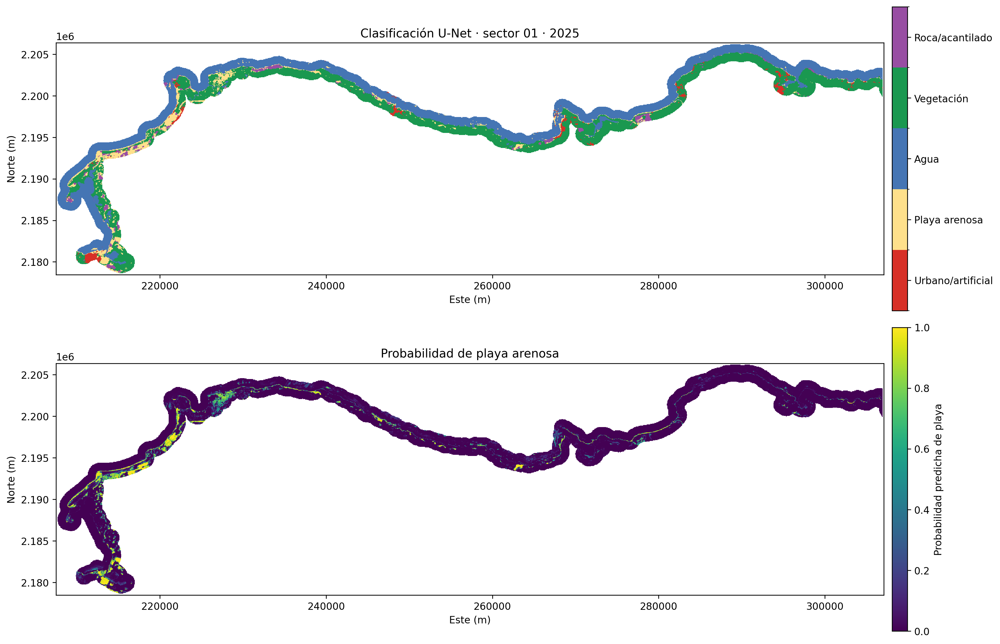{fig-align="center"}

::: {.smaller}
Figura original de la inferencia sectorial: clasificación y representaciones asociadas.
:::

## Ejemplo: sector 3

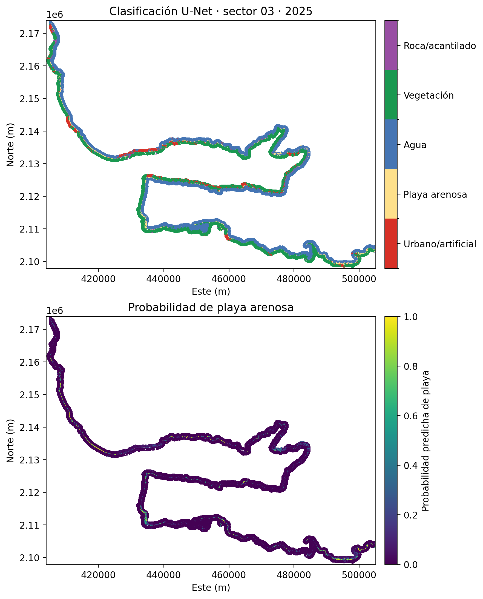{fig-align="center"}

## Ejemplo: sector 7

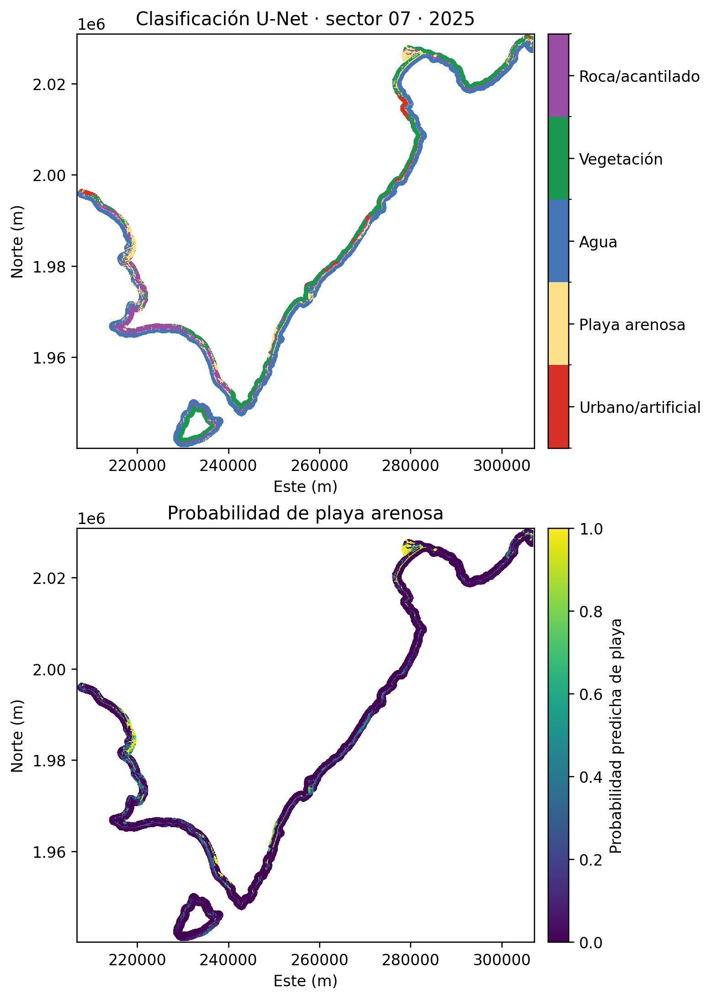{fig-align="center"}

## Distribución de probabilidades y confianza

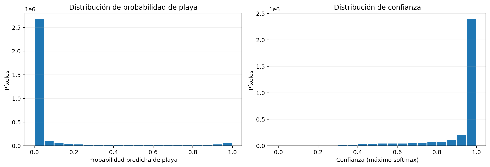{width="88%"}

::: {.smaller}
Histogramas del sector 1 generados por el cuaderno de inferencia; probabilidades y confianza no son equivalentes a exactitud cartográfica observada.
:::

## Mapa interactivo · aplicación pública de GEE {#mapa-gee}

::: {.content-visible when-format="revealjs"}
<iframe id="gee-app" title="Aplicación GEE de clasificación costera" src="about:blank" style="width:100%;height:650px;border:1px solid #b8cbd5;border-radius:10px;background:#f2f6f9" loading="lazy"></iframe>

:::

## Alternativa, por si nos quedamos sin internet

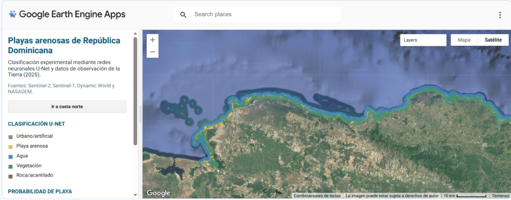{fig-align="center"}

<!-- ## De la clasificación a CoastSat -->

<!-- ::: {.r-stack} -->

<!-- ::: {.fragment .fade-in-then-out} -->
<!-- **1. U-Net** -->

<!-- Identificación de tramos arenosos candidatos -->
<!-- ::: -->

<!-- ::: {.fragment .fade-in-then-out} -->
<!-- **2. CoastSat** -->

<!-- Extracción multitemporal de líneas de costa -->
<!-- ::: -->

<!-- ::: {.fragment .fade-in-then-out} -->
<!-- **3. Transectos** -->

<!-- Desplazamientos, tendencias y heterogeneidad espacial -->
<!-- ::: -->

<!-- ::: {.fragment} -->
<!-- **4. Diagnóstico** -->

<!-- Erosión, acreción, estabilidad y priorización del seguimiento -->
<!-- ::: -->

<!-- ::: -->

## De la clasificación a CoastSat

- **U-Net** → selección de tramos arenosos candidatos

- **CoastSat** → extracción de posiciones multitemporales
  de la línea de costa

- **Transectos** → desplazamientos, tendencias y
  heterogeneidad espacial

- **Diagnóstico** → erosión, acreción, estabilidad y
  priorización del seguimiento

## Trudillé: ejemplo de aplicación CoastSat
(Apoyo a Gladys Rosado y su equipo, CIBIMA)

Casi 700 escenas disponibles desde 1985, ~400 aprovechables.

::: {.center}
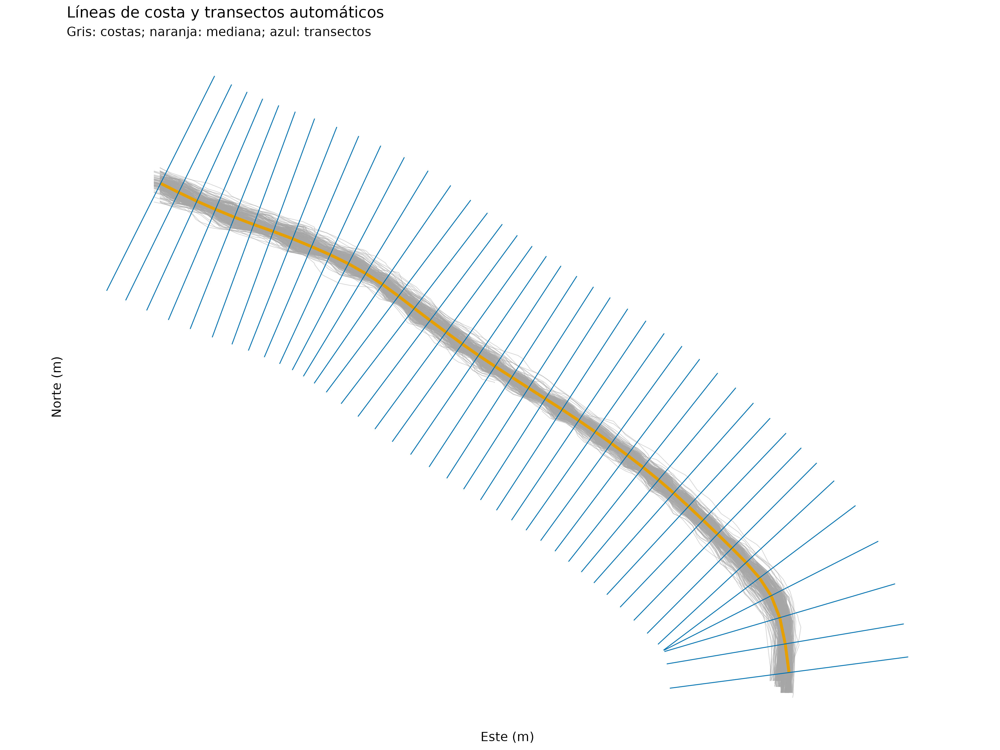{fig-align="center"}
:::

##

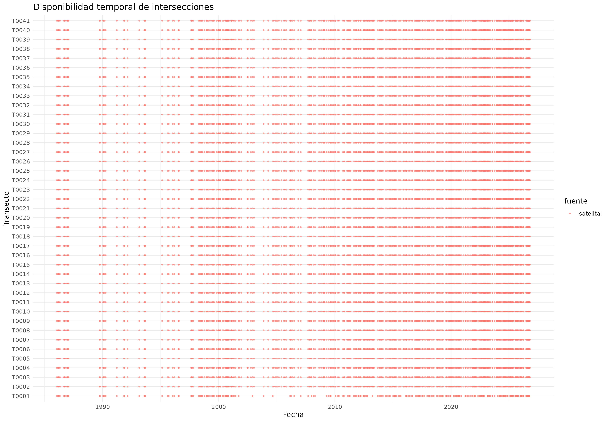{fig-align="center"}

##

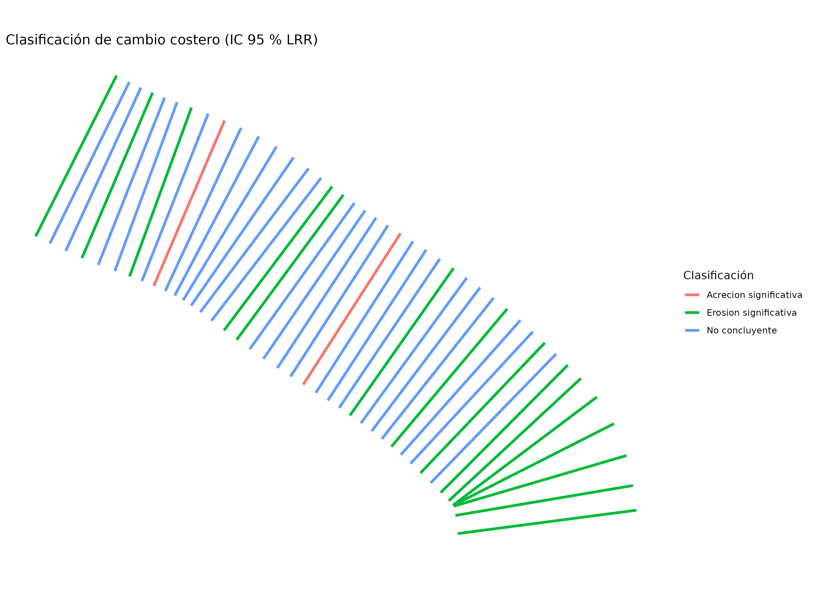{fig-align="center"}

::: {.smaller}
Ejemplo procedente del análisis previo de Trudillé. Ilustra la etapa de diagnóstico posterior a la selección de playas, no una validación del clasificador U-Net.
:::

## Trudillé: evolución temporal

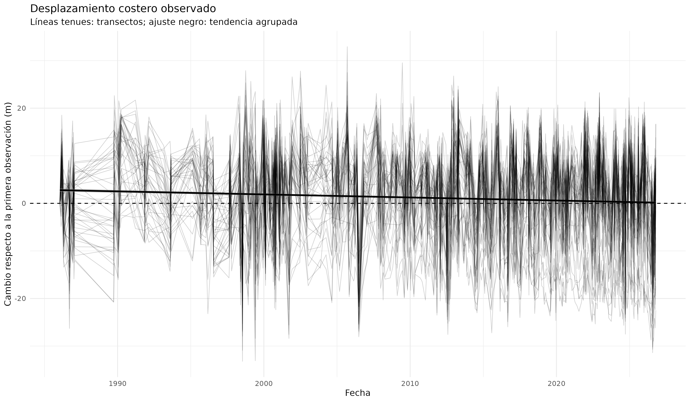{width="92%"}

## Trudillé: tendencias y modelos

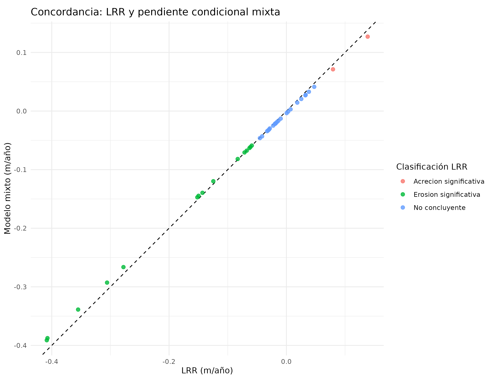{fig-align="center"}

## Trudillé: tendencias y modelos

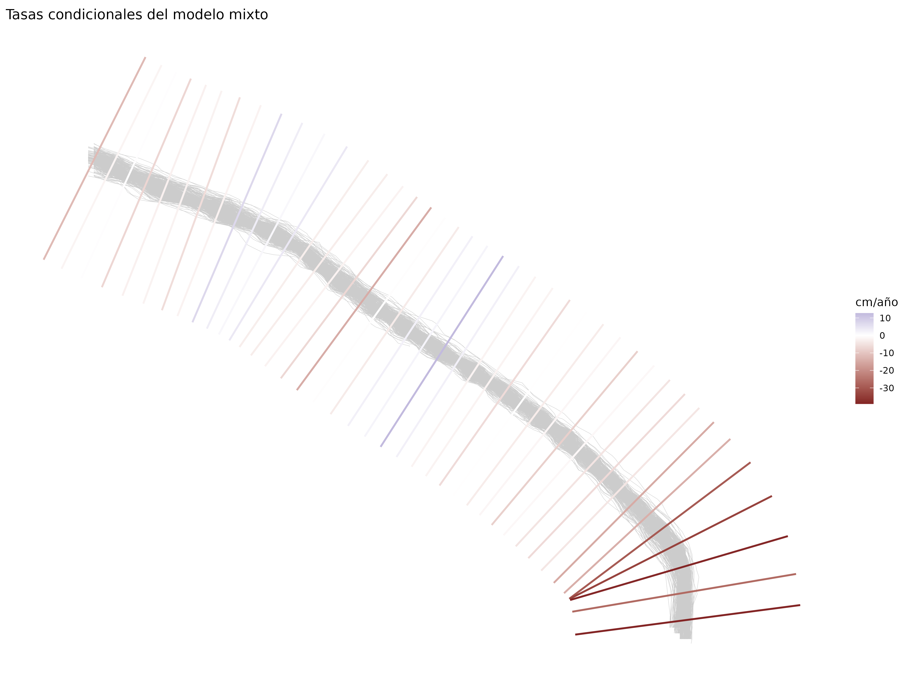{fig-align="center"}

## Limitaciones y controles necesarios

- Validación V5 limitada para playa arenosa (**468 píxeles** en el conjunto de validación reportado).
- Posibles errores de confusión entre superficies claras, arena y ambientes artificiales.
- Solapes de sectores: consolidar sin doble conteo antes de publicar superficies nacionales.
- Evaluación espacial independiente y revisión experta de tramos seleccionados.
- En CoastSat: resolución, nubosidad, oleaje, mareas y calidad de transectos.

## Perspectivas

1. Refinar etiquetas y ampliar muestras de playas y costas difíciles.
2. Construir una validación espacial independiente y por tipologías de costa.
3. Convertir píxeles de playa en **tramos costeros candidatos**, con continuidad y longitud.
4. Publicar mapas interactivos y productos abiertos reproducibles.
5. Aplicar CoastSat y el cuaderno de análisis de Trudillé a playas seleccionadas de todo el país.

## Conclusiones

- Se implementó un flujo operativo **GEE → U-Net/Colab → cartografía sectorial**.
- La inferencia cubre **siete sectores** del corredor litoral dominicano.
- El desempeño de playa es prometedor, pero requiere validación adicional antes de afirmaciones nacionales definitivas.
- El resultado aporta una **base para seleccionar tramos de seguimiento con CoastSat**.

**Gracias.**
